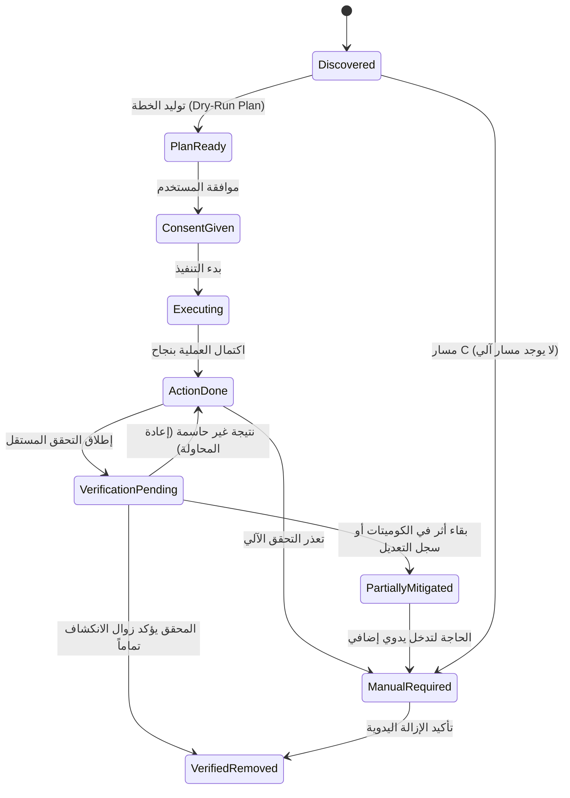
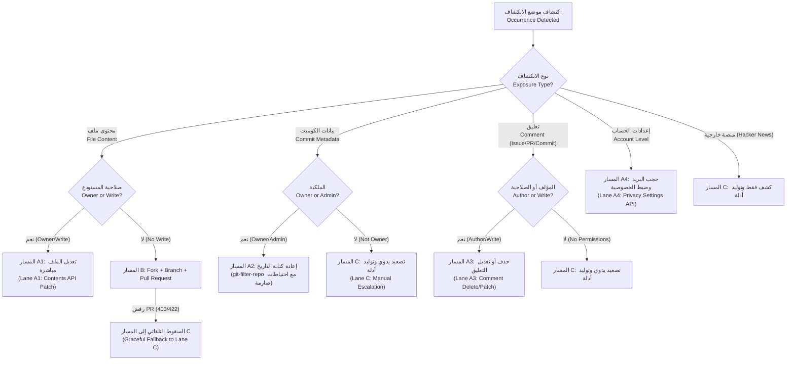
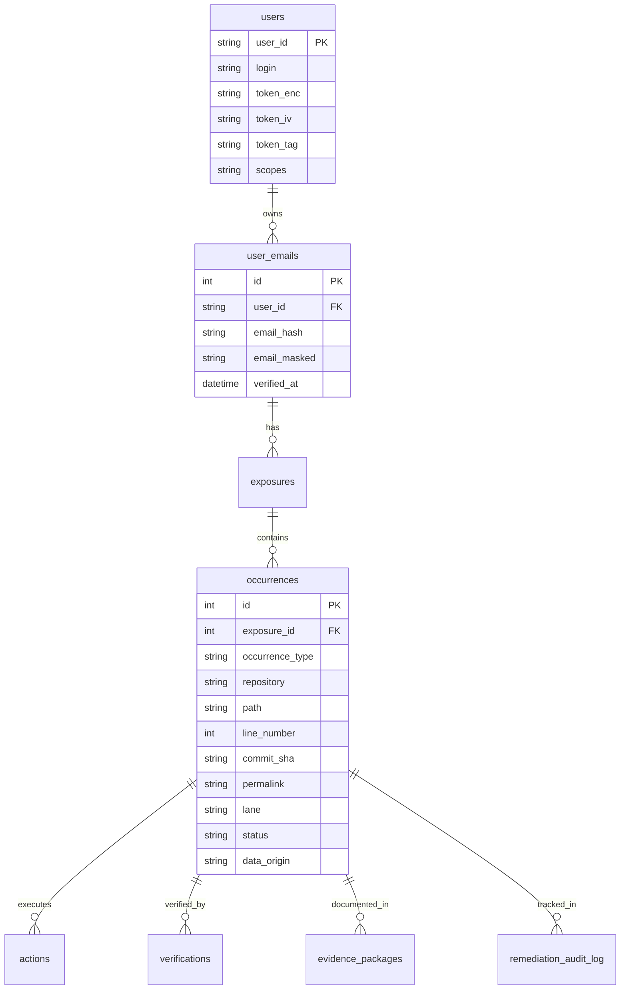

# SecureCheck — وثيقة التصميم المعماري / Architectural Design Document
## محرك المعالجة الآلية للانكشافات / Automated Exposure Remediation Engine

---

## 1. نظرة عامة والهدف / Overview & Objectives

يهدف **محرك المعالجة الآلية للانكشافات (Automated Exposure Remediation Engine)** في مشروع SecureCheck إلى تحويل مساعد إزالة الانكشافات (Exposure Removal Assistant) من مجرد إرشادات نصية وروابط استاتيكية إلى **محرك حقيقي مُنفّذ ومُتحقق منه**.

The engine transforms exposure remediation from passive advisory text into an automated, verified, and defensible workflow designed to withstand academic and technical defense committee review.

### المبادئ الصارمة / Core Invariants
1. **لا ادعاء لقدرات غير موجودة**: الالتزام الصارم بما تتيحه واجهات برمجة تطبيقات GitHub وسياساتها الأمنية.
2. **عدم إمكانية مسح المحتوى من مستودعات الغير**: المحرك يقدم مسار طلب التعديل (Pull Request) والمسار التصعيدي اليدوي (Lane C).
3. **عدم أتمتة إرسال طلبات الإزالة الخاصة لـ GitHub**: سياسة GitHub تمنع البوتات وتتطلب تقديم حزمة الأدلة يدوياً بواسطة صاحب الشأن.
4. **فصل المنفّذ عن المُحقّق**: لا يُعتبر أي إجراء مكتملاً بنجاح (`Verified Removed`) إلا عبر فحص مستقل بواسطة `verifier.js`.
5. **معاملة 401/403/429/5xx**: هذه الردود لا تعني إطلاقاً إزالة الانكشاف، بل تدل على خطأ صلاحيات أو حجب مؤقت أو مستودع خاص.
6. **دورة الأمان الإلزامية**: كل إجراء يمر بدورة: **خطة أولية (Dry-Run) ← موافقة صريحة من المستخدم ← تنفيذ آلي ← تحقق مستقل**.
7. **الخصوصية والتشفير**: التوكنات تُشفّر بـ `AES-256-GCM`، ولا تُسجّل في السجلات، وتُحذف فوراً عند الخروج.

---

## 2. آلة الحالات المنتهية / State Machine

يتبع المحرك آلة حالات صارمة (Finite State Machine) ذات 9 حالات محددة مسبقاً، مع قيود معمارية تمنع تجاوز الفحص المستقل.

### الحالات الـ 9 الرسمية:
1. `Discovered`: اكتشاف الانكشاف عبر فحص البريد الموثّق.
2. `PlanReady`: توليد خطة العمل الآمنة (عرض الفروقات Diff أو نص الطلب) بدون أي كتابة فعلية.
3. `ConsentGiven`: موافقة المستخدم الصريحة (بما في ذلك كتابة اسم المستودع لمسار A2).
4. `Executing`: العملية قيد التنفيذ عبر GitHub API أو الأدوات المعزولة.
5. `ActionDone`: نجاح استدعاء العملية الآلية.
6. `VerificationPending`: العملية قيد التدقيق المستقل.
7. `VerifiedRemoved`: **مُتحقق من إزالته بالكامل** (تُمنح فقط بواسطة المُحقّق).
8. `PartiallyMitigated`: **مُعالج جزئياً** (مثل حذف نص التعليق مع بقاء سجل المراجعات، أو تعديل HEAD مع بقاء الكوميت في التاريخ).
9. `ManualRequired`: يتطلب تدخلاً يدوياً (مسار الأدلة C، أو تصعيد لدعم GitHub).

---

## 3. مصفوفة التصنيف والمسارات / Classification Matrix & Lanes

---

## 4. تفاصيل المسارات التنفيذية / Detailed Remediation Lanes

### المسار A1 — تعديل الملف المباشر (Direct File Patch)
- **الآلية**: جلب الملف عبر `GET /repos/{owner}/{repo}/contents/{path}` للحصول على `sha` والمحتوى الأصلي.
- **الاستبدال الدقيق**: استبدال البريد الموثّق فقط بـ `[email removed]` دون مساس بأي سطر آخر.
- **التنفيذ**: إرسال `PUT` مع الـ `sha` وتحديث الملف مباشرة.
- **حماية الفروع (Branch Protection)**: في حال منع الـ commit المباشر على الفرع الافتراضي، ينشئ المحرك فرعاً داخلياً `securecheck/fix-...` ويفتح PR داخل المستودع نفسه ليقوم المستخدم بدمجه.
- **الملفات المستثناة**: الملفات الثنائية والملفات الأكبر من 1MB تُحوّل تلقائياً إلى المسار C مع توضيح السبب.

### المسار A2 — إعادة كتابة تاريخ المستودع (History Rewrite via git-filter-repo)
- **الأداة المستخدمة**: `git-filter-repo` (الإصدار 2.47.0+) مُشغّلة عبر `execFile` دون shell لضمان الأمان ومقاومة حقن الأوامر (Command Injection).
- **الخطوات النظامية الصارمة**:
  1. أخذ نسخة احتياطية كاملة عاكسة (`git clone --mirror`).
  2. استنساخ جديد في مجلد مؤقت معزول.
  3. إنشاء ملف `--mailmap` لاستبدال البريد المستهدف بعنوان GitHub No-reply المعتمد للمستخدم (مع التحقق من صحته بتعبير نمطي).
  4. فحص الفروقات قبل وبعد (تقرير بعدد الكوميتات المتأثرة ومطابقة شجرة الملفات `tree`).
  5. **حاجز الأمان الإلزامي**: لا يتم الدفع الإجباري (`force-push`) إلا بعد موافقة المستخدم الصريحة وكتابته لاسم المستودع بالكامل تأكيداً.
  6. **الواقعية التقنية**: بعد الـ force-push، تبقى النسخ في الـ forks وعروض التخزين المؤقت (GitHub cache) وروابط PRs؛ المحرك يُولّد تذكرة دعم جاهزة (`GitHub Support Ticket Bundle`) ليقوم المستخدم بتقديمها لدعم GitHub لحذف الـ cache، وتبقى الحالة `Partially Mitigated`.

### المسار A3 — معالجة التعليقات (Comments)
- **الحذف الكامل (Delete - الافتراضي)**: استخدام `DELETE` لحذف التعليق نهائياً من الـ Issue أو الـ PR أو الـ Commit.
- **التعديل (Patch)**: إذا اختار المستخدم التعديل، يُحذّره المحرك بأن سجل التعديلات (Edit History) في GitHub يبقى متاحاً للعامة، وتظل الحالة `Partially Mitigated` حتى يؤكد المستخدم حذف المراجعة يدوياً عبر الواجهة الرسومية لـ GitHub.

### المسار A4 — خصوصية الحساب (Account Privacy)
- تعديل ظهور البريد إلى الخاص عبر `PATCH /user/email/visibility` بالقيمة `private`.
- توجيه المستخدم لتفعيل خيار «Block command line pushes that expose my email» من إعدادات GitHub لحماية المستقبل.

### المسار B — مستودعات الغير (Third-Party Repositories)
- **الخطوات**:
  1. إنشاء Fork عبر `POST /repos/{owner}/{repo}/forks` مع استطلاع الجاهزية (Async Polling with Backoff).
  2. إنشاء فرع مخصص `securecheck/remove-email-<id>`.
  3. تعديل السطر المعني فقط.
  4. فتح Pull Request برسالة مهذبة ومقتضبة.
  5. سقف استخدام: PR واحد لكل مستودع، وسقف يومي للمستخدم لمنع الإزعاج (Anti-Spam).
  6. في حال حظر الـ PRs (403/422)، يسقط المحرك بنعومة إلى المسار C.

### المسار C — حزمة الأدلة والتصعيد اليدوي (Manual Escalation & Evidence Package)
- توليد حزمة Markdown احترافية تحتوي على:
  - نوع الانكشاف والمصدر.
  - الرابط الدائم (Canonical Permalink مع Commit SHA ورقم السطر).
  - مقتطف مقنَّع من السياق.
  - تقييم المخاطر وتوصية الإجراء.
  - مسودة رسالة جاهزة للتواصل مع مالك المستودع أو فريق أمان GitHub.

---

## 5. هيكل قاعدة البيانات / Database Schema

تمت إضافة 8 جداول متخصصة مرتبطة بنظام التشفير والأمان:

---

## 6. نموذج التهديدات والأمان / Threat Model & Security

| التهديد / Threat | الإجراء الوقائي في SecureCheck / Mitigation |
|------------------|--------------------------------------------|
| تسريب التوكنات (Token Exposure) | تشفير التوكنات بـ AES-256-GCM، حجبها من السجلات، وحذفها التام عند تسجيل الخروج |
| الفحص العشوائي (Unsolicited Scanning) | منع إدخال أي بريد غير موثّق في حساب GitHub المسجل (`verified=true`) |
| حظر معدل الطلبات (Rate Limiting) | طابور طلبات تسلسلي بفاصل 800ms ومعالجة أوتوماتيكية لـ `Retry-After` و `ETag` |
| تدمير بيانات المستودع في A2 | نسخة احتياطية كاملة (`--mirror`)، والتحقق من تطابق الشجرة، واشتراط كتابة اسم المستودع |
| ادعاء نجاح وهمي (False Positives) | الفحص المستقل يعامل 401/403/429 كأخطاء وليس كإزالة |
